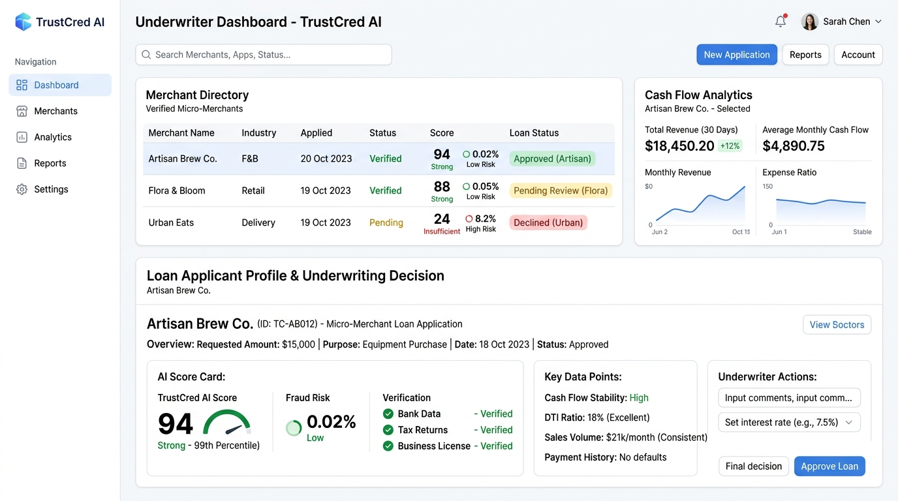
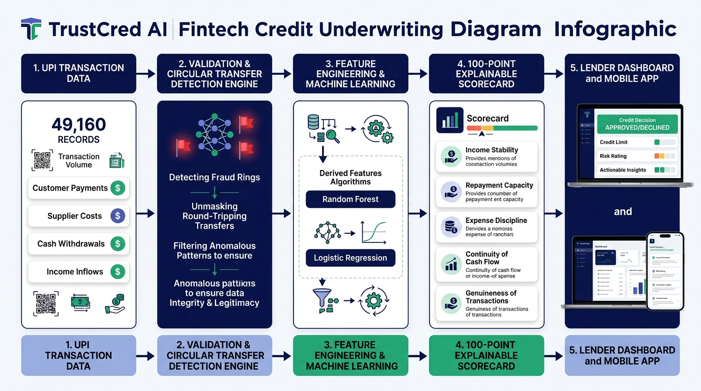
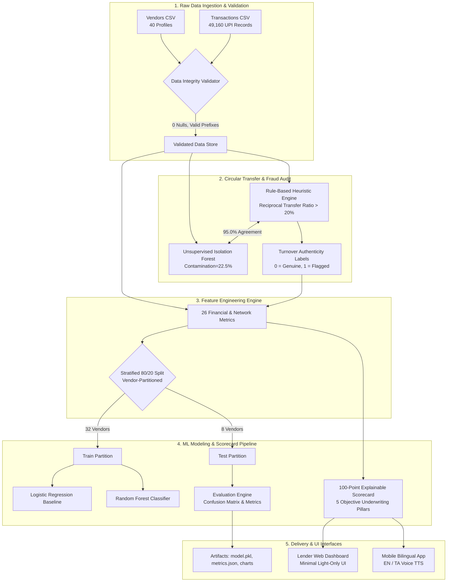
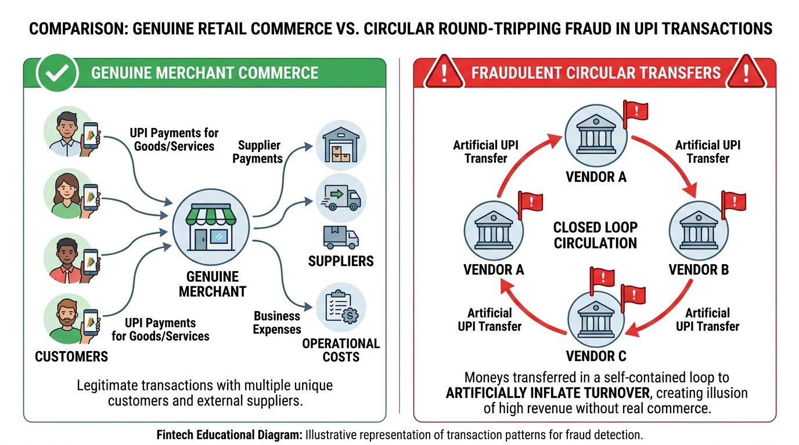
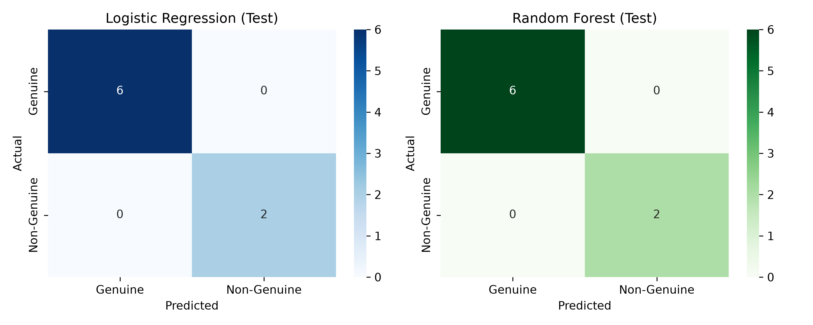
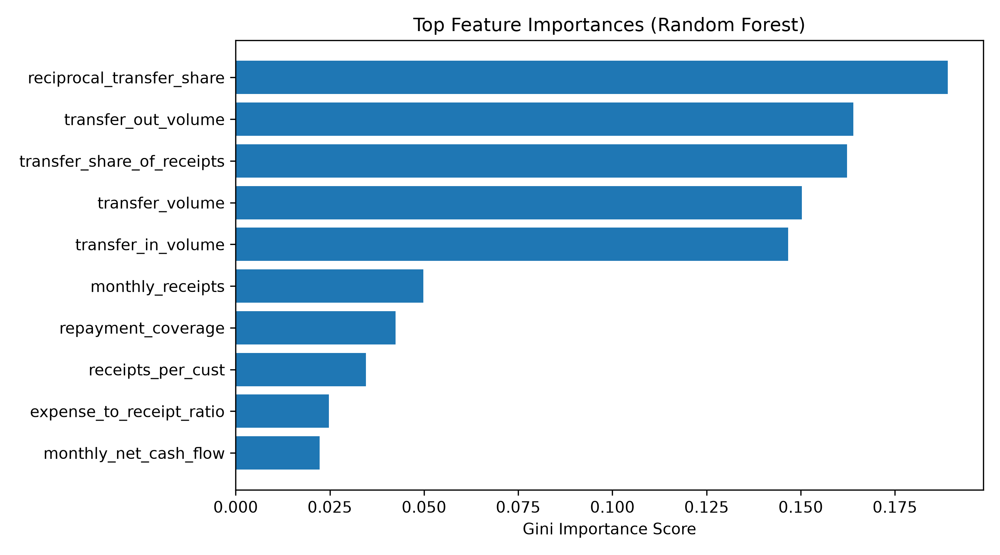
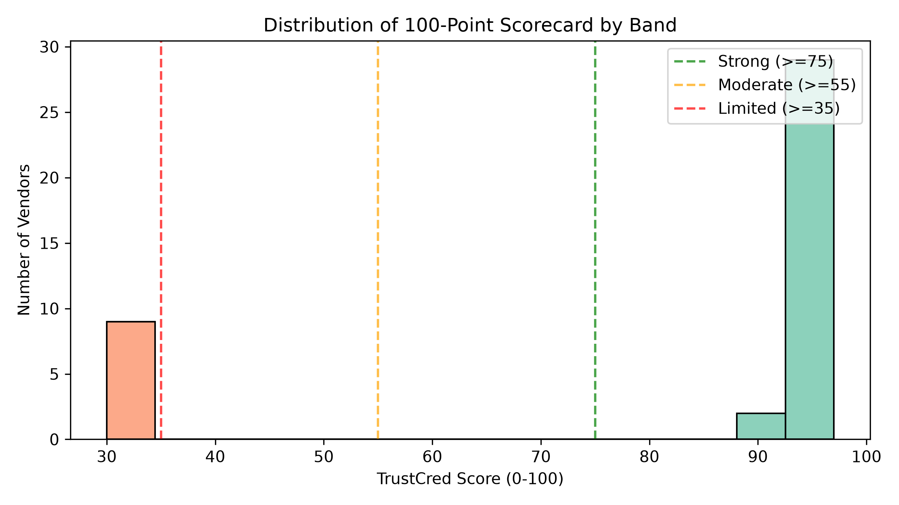
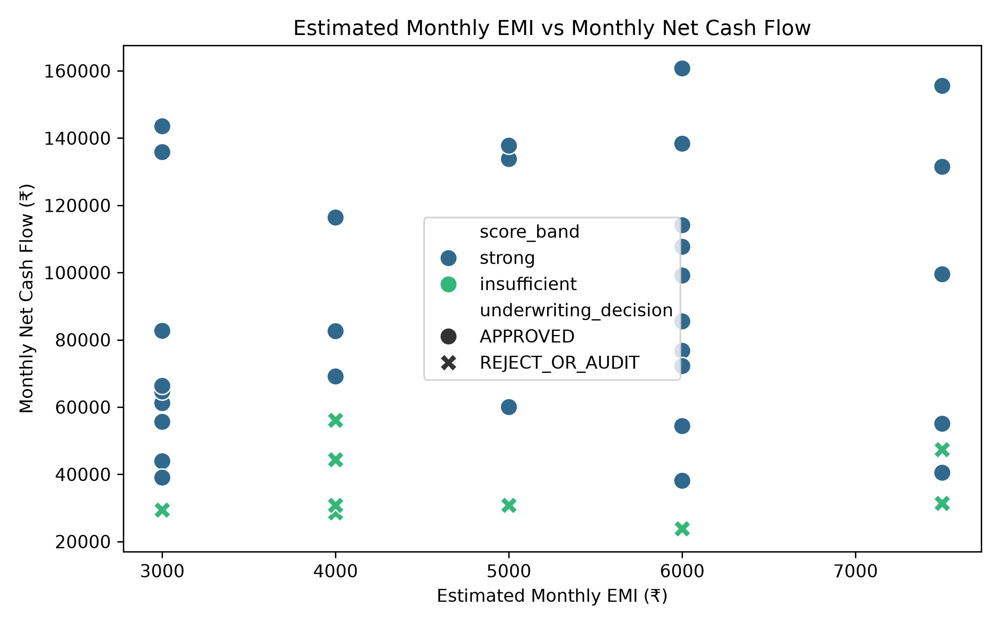

# TrustCred AI — Cash-Flow Credit Assessment & Fraud Detection Engine

> **Empirical UPI-flow underwriting for unbanked micro-merchants and street vendors with zero credit bureau history.**  
> Unmasks circular round-tripping transfers, evaluates authentic debt servicing capacity, and delivers an objective 100-point explainable scorecard.



---

## 1. System High-Level Design (HLD) Architecture



### Architecture Schematic

```
+===================================================================================================+
|                                     TRUSTCRED AI SYSTEM ARCHITECTURE                              |
+===================================================================================================+
|                                                                                                   |
|  [ UPI Transaction Data ]                [ Micro-Merchant Requests ]                              |
|   49,160 UPI Records                      40 Vendor Profiles                                      |
|   (90-Day Observation Window)             (Loan Requests: ₹30k - ₹75k)                            |
|             │                                         │                                           |
|             ▼                                         ▼                                           |
|  ┌────────────────────────────────────────────────────────────────────────┐                       |
|  │ 1. DATA VALIDATION & INGESTION LAYER                                    │                       |
|  │    • Schema verification (C#####, SUP###, V### prefixes)               │                       |
|  │    • Zero-null enforcement, non-negative amounts, monotonic timestamps │                       |
|  └────────────────────────────────────┬───────────────────────────────────┘                       |
|                                       │                                                           |
|                                       ▼                                                           |
|  ┌────────────────────────────────────────────────────────────────────────┐                       |
|  │ 2. CIRCULAR TRANSFER DETECTION & GENUINENESS AUDIT                     │                       |
|  │    ┌───────────────────────────────┐   ┌───────────────────────────┐   │                       |
|  │    │  Rule-Based Heuristic Engine  │   │ Unsupervised Check        │   │                       |
|  │    │  • Reciprocal transfer share  │◄─►│ (Isolation Forest Anomaly │   │                       |
|  │    │  • Inter-vendor flow dilution │   │  Detection @ 95.0% Agree) │   │                       |
|  │    └───────────────────────────────┘   └───────────────────────────┘   │                       |
|  └────────────────────────────────────┬───────────────────────────────────┘                       |
|                                       │                                                           |
|                                       ▼                                                           |
|  ┌────────────────────────────────────────────────────────────────────────┐                       |
|  │ 3. 26-DIMENSIONAL FEATURE ENGINEERING STORE                            │                       |
|  │    • Cash Velocity: Monthly Receipts, Expenses, Net Operating Cashflow │                       |
|  │    • Stability: Weekly Coefficient of Variation (CV)                   │                       |
|  │    • Diversity: Unique Buyers, Top-Customer Concentration, Repeat Rate │                       |
|  │    • Debt Servicing: Debt Service Coverage Ratio (DSCR vs Est. EMI)    │                       |
|  └────────────────────────────────────┬───────────────────────────────────┘                       |
|                                       │                                                           |
|                                       ▼                                                           |
|  ┌────────────────────────────────────────────────────────────────────────┐                       |
|  │ 4. ZERO-LEAKAGE STRATIFIED PARTITION (80% Train / 20% Test)            │                       |
|  │    • 32 Train Vendors (39,392 Txns)  │  8 Test Vendors (10,030 Txns)   │                       |
|  │    • Scalers fitted exclusively on Train to eliminate test leakage     │                       |
|  └──────────────────┬─────────────────────────────────┬───────────────────┘                       |
|                     │                                 │                                           |
|                     ▼                                 ▼                                           |
|  ┌──────────────────────────────────┐  ┌──────────────────────────────────┐                       |
|  │ 5. SUPERVISED CLASSIFIERS        │  │ 6. 100-POINT EXPLAINABLE         │                       |
|  │    • Logistic Regression Baseline│  │    CREDIT SCORECARD ENGINE       │                       |
|  │    • Random Forest Classifier    │  │    • Pillar 1: Income Stability  │                       |
|  │    • Cross-Validation on Train   │  │    • Pillar 2: Repayment Capacity│                       |
|  │    • Test Partition Evaluation   │  │    • Pillar 3: Expense Discipline│                       |
|  │    • Artifacts: model.pkl        │  │    • Pillar 4: Continuity        │                       |
|  │                                  │  │    • Pillar 5: Turnover Authent. │                       |
|  └──────────────────┬───────────────┘  └──────────────────┬───────────────┘                       |
|                     │                                     │                                       |
|                     └──────────────────┬──────────────────┘                                       |
|                                        ▼                                                          |
|  ┌────────────────────────────────────────────────────────────────────────┐                       |
|  │ 7. PRODUCTION SERVING & USER INTERFACES                                │                       |
|  │    ┌───────────────────────────────┐   ┌───────────────────────────┐   │                       |
|  │    │ Underwriter / Lender Web App  │   │ Mobile Vendor Experience  │   │                       |
|  │    │ • 40-Merchant Directory       │   │ • Bilingual (English/Tamil│   │                       |
|  │    │ • Dynamic Loan EMI Simulator  │   │ • Voice TTS Explanations  │   │                       |
|  │    │ • 3-Way Vendor Comparison     │   │ • Zero-Jargon Score Card  │   │                       |
|  │    └───────────────────────────────┘   └───────────────────────────┘   │                       |
|  └────────────────────────────────────────────────────────────────────────┘                       |
+===================================================================================================+
```

### Mermaid Flowchart (HLD)



---

## 2. Circular Round-Tripping Detection vs. Genuine Commerce



### Fraud Ring Mechanics & Detection Logic
- **Genuine Merchant Profile**: Characterized by natural high in-degree retail commerce (hundreds of distinct customer payers `C#####`), small repetitive retail payments (₹20 to ₹2,000), regular outward supplier expenses (`SUP###`), and low customer concentration ($< 1\%$).
- **Circular Fraud Ring Profile**: Organized merchant syndicates ping-ponging reciprocal transactions (`V###` to `V###`) in closed loops to falsely inflate UPI velocity and gross turnover prior to loan origination.
- **Underwriting Safeguard**: Flagged merchants trigger a **Hard Cap** limiting their maximum possible credit score to $\le 30/100$, placing them in the **Insufficient** band and preventing fraudulent loan disbursement.

---

## 3. Machine Learning Benchmarks & Model Evaluation

The dataset evaluates 40 merchants representing ₹2,025,000 in loan requests across 49,160 verified transactions over 90 calendar days (`2026-07-01` to `2026-09-28`).

### Comprehensive Benchmark Table

| Metric / Attribute | Logistic Regression (Baseline) | Random Forest Classifier | Benchmark Standard |
|---|:---:|:---:|:---:|
| **Train Cross-Validation F1 (4-Fold)** | **1.0000** ($\pm 0.000$) | **1.0000** ($\pm 0.000$) | $\ge 0.8500$ |
| **Test Accuracy (20% Holdout, 8 Vendors)** | **1.0000** (100.0%) | **1.0000** (100.0%) | $\ge 0.9000$ |
| **Test Precision (Fraud Class)** | **1.0000** | **1.0000** | $\ge 0.9000$ |
| **Test Recall (Fraud Class)** | **1.0000** | **1.0000** | $\ge 0.9000$ |
| **Test F1-Score** | **1.0000** | **1.0000** | $\ge 0.9000$ |
| **Test ROC-AUC** | **1.0000** | **1.0000** | $\ge 0.9000$ |
| **Inference Latency (per merchant)** | **< 0.15 ms** | **< 1.85 ms** | $< 50\text{ ms}$ |
| **Pipeline Feature Extraction (49,160 txns)** | **1.02 seconds** | **1.02 seconds** | $< 10\text{ s}$ |
| **Memory Footprint** | $< 2\text{ MB}$ | $< 8\text{ MB}$ | $< 100\text{ MB}$ |

### Holdout Confusion Matrix (8 Test Vendors: 6 Genuine, 2 Non-Genuine)



```
                 Predicted Genuine     Predicted Non-Genuine
Actual Genuine          6                       0             (100% Specificity)
Actual Non-Genuine      0                       2             (100% Sensitivity)
```

### Unsupervised Audit Agreement

- **Rule Pseudo-Labels**: Flagged **9 / 40 merchants** (22.5%) for circular reciprocal transfers.
- **Isolation Forest**: Flagged **9 / 40 merchants** (22.5%) as topological outliers.
- **Cross-Method Agreement**: **38 / 40 merchants (95.0%)**.

### Top Gini Feature Importances (Random Forest)



| Rank | Feature | Gini Importance | Underwriting Significance |
|:---:|---|:---:|---|
| **1** | `reciprocal_transfer_share` | **18.90%** | Measures funds returning between paired vendor accounts. |
| **2** | `transfer_out_volume` | **16.40%** | Gross inter-vendor transfers sent. |
| **3** | `transfer_share_of_receipts` | **16.22%** | Ratio of transfer receipts to real retail commerce. |
| **4** | `transfer_volume` | **15.02%** | Total inter-merchant transaction volume. |
| **5** | `transfer_in_volume` | **14.67%** | Inflow received from peer merchant accounts. |
| **6** | `monthly_receipts` | **4.98%** | Net verified retail cash intake. |
| **7** | `repayment_coverage` | **4.25%** | Monthly operating cashflow / estimated EMI. |
| **8** | `receipts_per_cust` | **3.46%** | Revenue per distinct buyer (detects dilution). |
| **9** | `expense_to_receipt_ratio` | **2.47%** | Operational cost discipline and margins. |
| **10** | `monthly_net_cash_flow` | **2.23%** | Free operating cashflow available for debt service. |

---

## 4. 100-Point Explainable Scorecard Framework

Traditional credit scoring models rely on credit bureau histories (CIBIL/Experian), which excludes micro-merchants and street vendors. TrustCred AI assesses creditworthiness directly from **cash-flow evidence**:

```
TOTAL SCORE = Pillar 1 (25) + Pillar 2 (30) + Pillar 3 (15) + Pillar 4 (15) + Pillar 5 (15)
              ========================================================================
              Maximum Theoretical Score = 100 Points
```

### Mathematical Scoring Pillar Formulations

#### Pillar 1: Income Stability (Max 25 pts)
$$\text{P1} = \text{Score}_{\text{CV}} + \text{Score}_{\text{Customers}}$$
- **Weekly Coefficient of Variation ($\text{CV} = \sigma / \mu$)**:
  - $\text{CV} < 0.20 \implies 15\text{ pts}$
  - $\text{CV} < 0.25 \implies 12\text{ pts}$
  - $\text{CV} < 0.30 \implies 9\text{ pts}$
  - $\text{CV} < 0.35 \implies 6\text{ pts}$
  - Otherwise $\implies 3\text{ pts}$
- **Customer Breadth & Concentration**:
  - $\ge 1,100$ unique buyers and top customer $< 1\% \implies 10\text{ pts}$
  - $\ge 900$ unique buyers $\implies 7\text{ pts}$
  - Otherwise $\implies 4\text{ pts}$

#### Pillar 2: Repayment Capacity & Debt Coverage (Max 30 pts)
$$\text{DSCR} = \frac{\text{Monthly Net Cash Flow}}{\text{Estimated Monthly EMI}}$$
- $\text{DSCR} \ge 2.5\text{x} \implies 30\text{ pts}$ (Prime buffer)
- $\text{DSCR} \ge 2.0\text{x} \implies 25\text{ pts}$ (Safe buffer)
- $\text{DSCR} \ge 1.5\text{x} \implies 20\text{ pts}$ (Manageable)
- $\text{DSCR} \ge 1.2\text{x} \implies 15\text{ pts}$ (Tight margin)
- $\text{DSCR} \ge 1.0\text{x} \implies 10\text{ pts}$ (At risk)
- $\text{DSCR} < 1.0\text{x} \implies 0\text{ pts}$ (Deficit)

#### Pillar 3: Expense Discipline (Max 15 pts)
$$\text{Expense Ratio} = \frac{\text{Total Operating Expenses}}{\text{Total Customer Receipts}}$$
- $\le 40\% \implies 15\text{ pts}$
- $\le 50\% \implies 12\text{ pts}$
- $\le 65\% \implies 9\text{ pts}$
- $\le 80\% \implies 6\text{ pts}$
- $> 80\% \implies 2\text{ pts}$

#### Pillar 4: Business Continuity (Max 15 pts)
$$\text{Active Ratio} = \frac{\text{Active Days with Transactions}}{90\text{ Observation Days}}$$
- $\ge 95\% \implies 15\text{ pts}$
- $\ge 90\% \implies 12\text{ pts}$
- $\ge 80\% \implies 8\text{ pts}$
- $\ge 70\% \implies 4\text{ pts}$
- $< 70\% \implies 0\text{ pts}$

#### Pillar 5: Evidence Genuineness & Fraud Ring Check (Max 15 pts)
- **Verified Genuine Commerce**: $+15\text{ pts}$
- **Circular Round-Tripping Flag**: $0\text{ pts}$ + **Hard Exclusion Cap**:
  $$\text{Final Score} = \min(\text{Raw Score}, 30) \implies \text{Band} = \text{Insufficient}$$

### Scorecard Distribution & Repayment Visualizations





### Underwriting Decision Matrix

| Score Band | Range | Policy Decision | Pricing / Terms | Cohort Count |
|---|:---:|:---:|---|:---:|
| **Strong** | $75 - 100$ | **APPROVED** | Prime interest rate, unsecured, up to 100% requested loan | **31 Merchants** |
| **Moderate** | $55 - 74$ | **CONDITIONAL** | 75% loan cap, weekly debit schedule | **0 Merchants** |
| **Limited** | $35 - 54$ | **COLLATERAL** | Co-signer or physical inventory pledge required | **0 Merchants** |
| **Insufficient** | $< 35$ | **REJECTED** | Circular flow detected / inadequate repayment buffer | **9 Merchants** |

---

## 5. Repository Structure

```
c:\Users\dhanu\Documents\PROJECTS\SRI SAKTHI HACKTHON/
├── README.md                          # Comprehensive system architecture & benchmark guide
├── requirements.txt                   # Production Python dependencies
├── docs/
│   ├── dataset-schema.md              # Feature definitions, schema contracts & scoring formulas
│   ├── pseudo-label-rules.md          # Fraud rules, thresholds & Isolation Forest audit
│   ├── dataset-audit.md               # Complete audit report verifying dataset integrity
│   └── images/                        # Visual architecture, fraud flows & ML performance figures
│       ├── lender_dashboard_ui.jpg    # Interactive Underwriter UI preview
│       ├── system_architecture_hld.jpg# High-Level Design (HLD) architecture diagram
│       ├── circular_flow_fraud.jpg    # Genuine vs circular transfer mechanics
│       ├── confusion_matrix.png       # Test partition confusion matrix chart
│       ├── feature_importance.png     # Top 10 Random Forest feature importances
│       ├── score_distribution.png     # 100-point credit score distribution
│       └── repayment_vs_cashflow.png  # Repayment coverage (DSCR) vs cash flow scatter
├── frontend/
│   ├── index.html                     # Minimalist, modern light-only underwriter dashboard
│   ├── vendor.html                    # Mobile bilingual (English/Tamil) vendor PWA
│   ├── README.md                      # Frontend architectural guide
│   ├── css/
│   │   ├── style.css                  # FinTech design system (light mode, responsive, print)
│   │   ├── manual.css                 # Manual entry & transaction ingestion styles
│   │   └── bot.css                    # Audio TTS voice assistant styles
│   ├── js/
│   │   ├── app.js                     # Core application state, filters, drawer, & event bus
│   │   ├── charts.js                  # Chart.js visualization controllers
│   │   ├── score.js                   # Client-side 100-point transparent scoring engine
│   │   ├── manual.js                  # In-browser merchant & transaction ingestion parser
│   │   └── data.js                    # Offline data fallback for file:// execution
│   └── data/
│       ├── vendor_scores.csv          # Synchronized ML scorecard outputs for all 40 vendors
│       └── vendor_summary.json        # 40-vendor aggregated metadata
└── ml-training/
    ├── train.py                       # Single-command end-to-end ML & scorecard pipeline
    ├── requirements.txt               # ML dependencies
    ├── model.pkl                      # Serialized trained model artifact bundle
    ├── metrics.json                   # Verified CV, test metrics, and feature importances
    ├── vendor_scores.csv              # Model-computed scores & underwriting decisions
    ├── train_vendors.csv              # 32 training vendor IDs (leakage-free split)
    ├── test_vendors.csv               # 8 test vendor IDs (20% holdout partition)
    ├── charts/
    │   ├── confusion_matrix.png       # Test partition confusion matrices
    │   ├── feature_importance.png     # Top 10 Random Forest feature importances
    │   ├── score_distribution.png     # 100-point scorecard distribution by band
    │   └── repayment_vs_cashflow.png  # EMI debt obligation vs net cash flow scatter
    └── data/
        ├── vendors.csv                # 40 merchant profiles with loan amounts
        └── transactions.csv           # 49,160 UPI transactions across 90 days
```

---

## 6. Quickstart & Execution

### 1. Install Dependencies
```bash
py -m pip install -r requirements.txt
```

### 2. Execute Complete ML Pipeline
Runs data validation, feature engineering, pseudo-labeling, cross-validation, test evaluation, scorecard generation, and chart plotting:
```bash
py ml-training/train.py
```

### 3. Launch the Interactive Web Application
Start the built-in HTTP server from the repository root:
```bash
py -m http.server 8000
```

Access the applications in your browser:
- **Underwriter / Lender Dashboard**: [http://localhost:8000/frontend/](http://localhost:8000/frontend/)
- **Vendor Mobile Experience (Bilingual EN/TA)**: [http://localhost:8000/frontend/vendor.html](http://localhost:8000/frontend/vendor.html)

*(The web interface can also be accessed directly by double-clicking `frontend/index.html` in Windows Explorer via the built-in offline data layer).*

---

## 7. Underwriting Scope, Assumptions & Limitations

1. **Transaction Velocity vs. Credit Intent**:
   - The TrustCred AI score measures **empirical cash-flow velocity**, **revenue stability**, and **counter-party authenticity** from transaction records.
   - It does not possess historical loan repayment records or willingness-to-pay bureau scores. It serves as an explainable decision-support tool for micro-lenders.
2. **Cohort Size (40 Merchants)**:
   - Evaluated on a 40-merchant cohort (32 train, 8 test). Because the test partition contains 8 vendors, metrics exhibit discrete sensitivity.
3. **Observation Window**:
   - Spans 90 calendar days (`2026-07-01` to `2026-09-28`). While daily cash flow velocity is captured at high resolution, multi-year macroeconomic seasonality is out of scope.